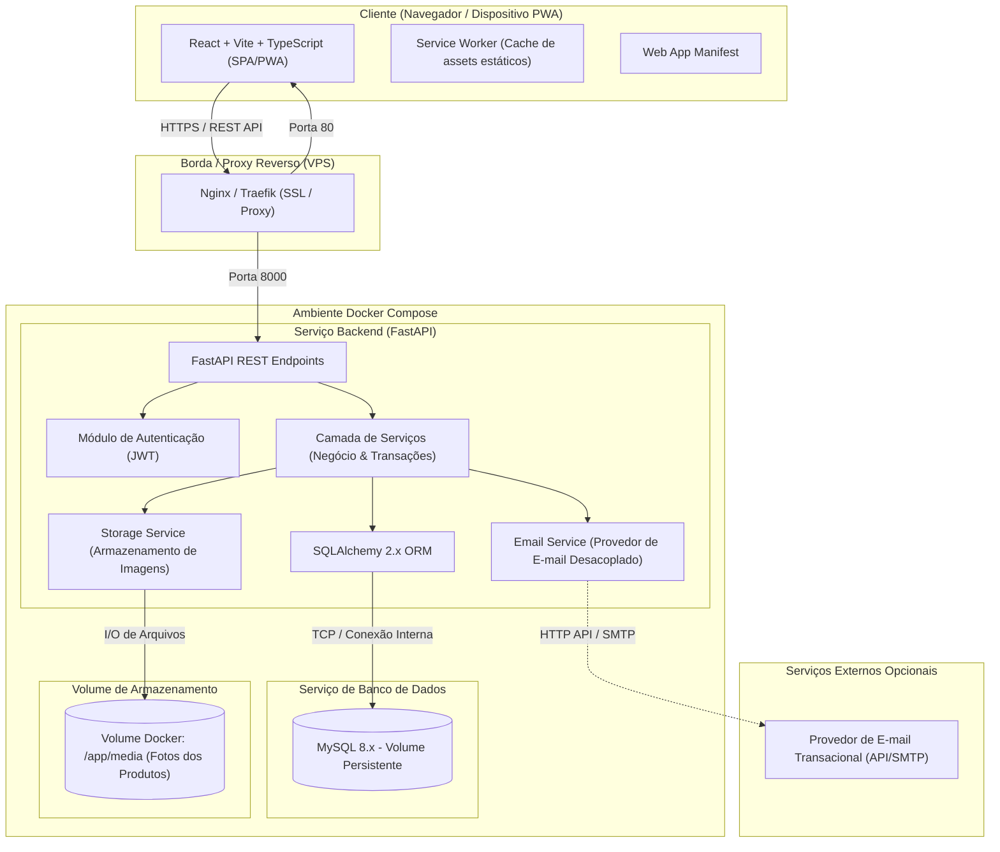

# Casa Luma Estoque — Arquitetura de Software

Este documento descreve a arquitetura técnica, os padrões de projeto, a infraestrutura e as decisões estruturais do sistema de controle de estoque do **Ateliê Casa Luma**.

---

## 1. Visão Geral e Objetivos

O **Casa Luma Estoque** é uma aplicação web empresarial projetada para gerenciar todo o ciclo de produtos artesanais, matérias-primas, embalagens, materiais auxiliares, estoque, produção (fichas técnicas), vendas e relatórios analíticos.

### Princípios Norteadores
1. **Rastreabilidade e Imutabilidade:** Nenhuma movimentação de estoque confirmada pode ser alterada ou apagada destrutivamente. Correções são feitas via novas movimentações ou reversões auditáveis.
2. **Atomicidade e Integridade Transacional:** Operações que afetam múltiplos itens (como produção ou vendas) devem ser executadas em transação única no banco de dados (`ACID`). Falhas parciais são proibidas.
3. **Consistência de Saldos no Backend:** O saldo em estoque é validado e computado exclusivamente no backend; o frontend nunca define ou dita o saldo de um item.
4. **Desacoplamento de Serviços:** Serviços auxiliares (como envio de e-mails de alerta e armazenamento de fotos) operam sob interfaces abstratas configuráveis por variáveis de ambiente.
5. **Identidade Visual Artesanal e Acolhedora:** Interface com estética minimalista e elegante (paleta quente/neutra em tons de areia, cimento e off-white, tipografia Cormorant Garamond e Manrope), mantendo ergonomia administrativa e suporte a PWA.

---

## 2. Diagrama de Arquitetura

O diagrama abaixo ilustra os componentes da solução e seus fluxos de integração:



---

## 3. Estrutura de Diretórios do Projeto

A organização de código do projeto segue uma divisão limpa entre backend, frontend, infraestrutura e documentação:

```text
casa-luma-estoque/
├── backend/
│   ├── app/
│   │   ├── api/                  # Routers da API REST (v1)
│   │   │   ├── v1/
│   │   │   │   ├── endpoints/    # auth, users, products, stock, recipes, sales, etc.
│   │   │   │   └── api_router.py
│   │   ├── core/                 # Configurações globais, segurança, DB engine, deps
│   │   │   ├── config.py         # Pydantic BaseSettings (.env)
│   │   │   ├── database.py       # SQLAlchemy SessionLocal, Engine
│   │   │   ├── security.py       # Hashing de senhas, JWT encode/decode
│   │   │   └── dependencies.py   # Injeção de dependências (get_db, current_user)
│   │   ├── models/               # Entidades declarativas SQLAlchemy 2.x
│   │   ├── schemas/              # Schemas Pydantic v2 (Input, Output, Filtros)
│   │   ├── services/             # Regras de negócio, transações e validações
│   │   │   ├── stock_service.py
│   │   │   ├── production_service.py
│   │   │   ├── sale_service.py
│   │   │   ├── storage_service.py # Upload e gestão de imagens locais/remotas
│   │   │   └── email_service.py   # Driver de e-mail e deduplicação
│   │   └── main.py               # Inicialização da aplicação FastAPI
│   ├── migrations/               # Alembic (versões do schema MySQL)
│   ├── tests/                    # Testes automatizados (pytest)
│   ├── Dockerfile
│   ├── requirements.txt
│   └── .env.example
├── frontend/
│   ├── public/
│   │   ├── icons/                # Ícones PWA (192x192, 512x512, etc.)
│   │   ├── manifest.webmanifest  # Configuração PWA
│   │   └── favicon.ico
│   ├── src/
│   │   ├── api/                  # Clientes HTTP (Axios/Fetch configurados)
│   │   ├── components/           # Componentes UI reutilizáveis (botões, inputs, cards, badges)
│   │   ├── layouts/              # Layout principal (Sidebar, Header, Área de Conteúdo)
│   │   ├── pages/                # Telas (Dashboard, Produtos, Estoque, Produção, Vendas, Relatórios)
│   │   ├── routes/               # Rotas do React Router com guards de autenticação
│   │   ├── hooks/                # Hooks customizados (useAuth, useStock, etc.)
│   │   ├── types/                # Definições de tipos TypeScript
│   │   ├── styles/               # Tokens CSS globais, reset e variáveis de tema
│   │   └── sw.js                 # Service Worker do PWA
│   ├── package.json
│   ├── tsconfig.json
│   ├── vite.config.ts
│   ├── Dockerfile
│   └── .env.example
├── docs/                         # Documentação técnica de apoio
│   ├── arquitetura.md
│   ├── modelo-de-dados.md
│   └── api.md
├── docker-compose.yml            # Orquestração local e para VPS
├── .gitignore
└── README.md
```

---

## 4. Detalhamento dos Componentes

### 4.1 Backend (Python / FastAPI)
- **FastAPI:** Framework assíncrono de alto desempenho com documentação OpenAPI/Swagger automática.
- **SQLAlchemy 2.0:** Mapeamento objeto-relacional com tipagem estrita (`Mapped`, `mapped_column`) e controle explícito de transações (`session.begin()`).
- **Pydantic v2:** Validação de entradas e serialização de saídas com garantia de tipos, campos numéricos decimais (`Decimal`) e sanitização.
- **Alembic:** Controle de versionamento do schema do banco de dados MySQL via migrações rastreáveis.
- **Segurança:**
  - Hashes de senha gerados com `passlib[bcrypt]` ou `argon2-cffi`.
  - Tokens de acesso JWT assinados com `HS256`, expiração explícita e segredo injetado via variável de ambiente.
  - Endpoints de login e recuperação de senha implementados com proteção contra enumeração de usuários (respostas de tempo constante e mensagens padronizadas).

### 4.2 Frontend (React / Vite / TypeScript / PWA)
- **Vite:** Empacotador moderno com suporte a Hot Module Replacement (HMR) rápido.
- **TypeScript:** Tipagem estática rigorosa para espelhar contratos da API e evitar falhas de runtime.
- **Design System com Vanilla CSS / CSS Variables:**
  - Sistema de tokens para tipografia, espaçamentos, sombras sutis e paleta inspirada no Ateliê Casa Luma.
  - Tipografia: **Cormorant Garamond** para títulos e identidade artesanal; **Manrope** para densidade informacional, números e formulários operacionais.
  - Responsividade nativa: Layout adaptativo com sidebar recolhível no desktop e cartões/linhas empilhadas no mobile.
- **Progressive Web App (PWA):**
  - Manifesto com metadados para instalação na tela inicial de celulares e desktops.
  - Service Worker para cache de assets estáticos (HTML, JS, CSS, fontes e ícones).
  - Política de segurança para offline: operações de alteração de estoque são estritamente bloqueadas sem rede ativa para evitar divergências.

### 4.3 Banco de Dados (MySQL 8.x)
- Motor padrão: `InnoDB` com suporte a chaves estrangeiras e transações completas.
- Codificação de caracteres: `utf8mb4` com collation `utf8mb4_unicode_ci`.
- Tipos de dados monetários e quantitativos:
  - `DECIMAL(10, 2)` para valores monetários (evitando erros de ponto flutuante binário).
  - `DECIMAL(10, 4)` para custos unitários fracionados de insumos.
  - `DECIMAL(10, 3)` para quantidades físicas e frações de unidades (ex.: 0.250 kg, 1.500 L).

### 4.4 Armazenamento de Arquivos e Fotos (`StorageService`)
- As imagens dos produtos acabados **não são armazenadas em Base64 no MySQL**.
- O backend recebe o upload multipart, valida:
  1. Extensão do arquivo (`.jpg`, `.jpeg`, `.png`, `.webp`).
  2. Tipo MIME real via inspeção de cabeçalho binário (magic bytes).
  3. Dimensões e tamanho máximo (limite inicial configurável: 3 MB).
- O arquivo é persistido com nome sanitizado e UUID v4 único em um volume Docker dedicado (`media/`).
- O banco armazena apenas a referência relativa, metadados (tamanho, MIME, se é a foto principal) e ordenação.
- O serviço possui interface abstrata para que, no futuro, a implementação possa ser alternada para AWS S3, Cloudflare R2 ou MinIO sem afetar os controllers.

### 4.5 Notificações de E-mail (`EmailService`)
- Interface desacoplada `EmailService` contendo o método assíncrono `send_email(to, subject, body_html)`.
- Implementação inicial `LogStubEmailService` (em desenvolvimento/sem credenciais) que apenas loga a mensagem estruturada e registra o status `SKIPPED`/`MOCK`.
- Estratégia de deduplicação: antes de disparar alertas de estoque mínimo/zerado, o sistema consulta a tabela `email_notification_logs` para evitar disparos repetidos no mesmo ciclo (respeitando intervalo configurável, ex.: 24 horas).
- Falhas de e-mail nunca causam `rollback` de transações de estoque já confirmadas.

---

## 5. Estratégia de Implantação e Infraestrutura

A aplicação foi desenhada para deploy simples e confiável em qualquer **Virtual Private Server (VPS)** rodando Linux:

1. **Docker Compose:**
   - Container `db`: MySQL 8.x (porta 3306 acessível apenas pela rede interna do Docker).
   - Container `backend`: Aplicação FastAPI servida via `uvicorn` sob processo controlado.
   - Container `frontend`: Assets estáticos compilados e servidos por Nginx Alpine leve.
2. **Reverse Proxy & TLS:**
   - Na VPS, um proxy reverso (Nginx ou Caddy) gerencia os certificados SSL/TLS automáticos (Let's Encrypt) e redireciona `/api` para o backend e `/` para o frontend.
3. **Backup e Persistência:**
   - Volumes declarados para o MySQL (`casaluma_db_data`) e para uploads (`casaluma_media_data`).
   - Scripts automatizados fornecidos na pasta `scripts/`:
     - `scripts/backup.sh` / `scripts/backup.ps1`: exporta dump transacional do MySQL comprimido em `.sql.gz` e compacta o volume de mídias em `.tar.gz`, gerando manifesto de integridade `manifest.json`. Suporta rotação automática de retenção (14 dias).
     - `scripts/restore.sh` / `scripts/restore.ps1`: rotina para restauração completa de dados e mídias a partir de qualquer pasta de backup gerada.
