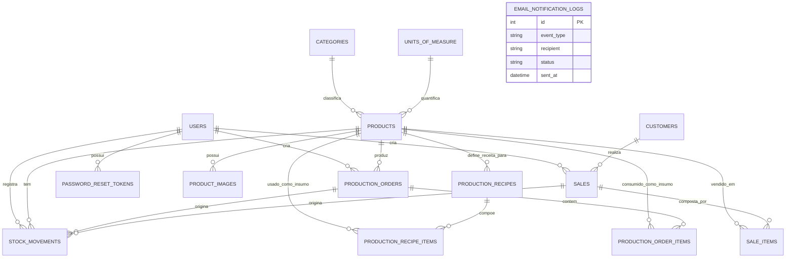

# Casa Luma Estoque — Modelo de Dados Relacional

Este documento detalha o modelo relacional de banco de dados para o sistema **Casa Luma Estoque**, incluindo entidades, tipos de colunas, restrições, índices e relacionamentos.

---

## 1. Diagrama Entidade-Relacionamento (ER)

---

## 2. Dicionário de Dados

### 2.1 Usuários e Segurança

#### Tabela `users`
Armazena as contas administrativas e operacionais do sistema.
| Coluna | Tipo | Nulo | Padrão | Descrição |
| :--- | :--- | :--- | :--- | :--- |
| `id` | `INT UNSIGNED` | Não | Auto-inc | Identificador único |
| `email` | `VARCHAR(191)` | Não | - | E-mail corporativo (Único) |
| `hashed_password` | `VARCHAR(255)` | Não | - | Hash bcrypt/argon2 da senha |
| `full_name` | `VARCHAR(120)` | Não | - | Nome completo do usuário |
| `is_active` | `BOOLEAN` | Não | `TRUE` | Status de ativação da conta |
| `is_admin` | `BOOLEAN` | Não | `FALSE` | Permissão administrativa |
| `created_at` | `DATETIME` | Não | `CURRENT_TIMESTAMP` | Data/hora de cadastro |
| `updated_at` | `DATETIME` | Não | `CURRENT_TIMESTAMP ON UPDATE CURRENT_TIMESTAMP` | Última modificação |

**Índices:**
- `PRIMARY KEY (id)`
- `UNIQUE INDEX idx_users_email (email)`

#### Tabela `password_reset_tokens`
Tokens para recuperação e redefinição segura de senhas.
| Coluna | Tipo | Nulo | Padrão | Descrição |
| :--- | :--- | :--- | :--- | :--- |
| `id` | `INT UNSIGNED` | Não | Auto-inc | Identificador único |
| `user_id` | `INT UNSIGNED` | Não | - | FK para `users.id` |
| `token_hash` | `VARCHAR(64)` | Não | - | Hash SHA-256 do token único |
| `expires_at` | `DATETIME` | Não | - | Limite de expiração (ex.: 2h) |
| `used_at` | `DATETIME` | Sim | `NULL` | Data de consumo (uso único) |
| `created_at` | `DATETIME` | Não | `CURRENT_TIMESTAMP` | Criação da solicitação |

**Restrições e Índices:**
- `FOREIGN KEY (user_id) REFERENCES users(id) ON DELETE CASCADE`
- `INDEX idx_tokens_lookup (token_hash, used_at, expires_at)`

---

### 2.2 Cadastros Base e Catálogo

#### Tabela `categories`
Categorias para agrupamento lógico dos itens (ex.: Velas, Sabonetes, Óleos, Frascos).
| Coluna | Tipo | Nulo | Padrão | Descrição |
| :--- | :--- | :--- | :--- | :--- |
| `id` | `INT UNSIGNED` | Não | Auto-inc | Identificador único |
| `name` | `VARCHAR(80)` | Não | - | Nome da categoria |
| `description` | `VARCHAR(255)` | Sim | `NULL` | Descrição opcional |
| `is_active` | `BOOLEAN` | Não | `TRUE` | Status de ativação |
| `created_at` | `DATETIME` | Não | `CURRENT_TIMESTAMP` | Data de criação |

**Índices:**
- `PRIMARY KEY (id)`
- `UNIQUE INDEX idx_categories_name (name)`

#### Tabela `units_of_measure`
Unidades padronizadas de movimentação (inteiras ou fracionadas).
| Coluna | Tipo | Nulo | Padrão | Descrição |
| :--- | :--- | :--- | :--- | :--- |
| `id` | `INT UNSIGNED` | Não | Auto-inc | Identificador único |
| `code` | `VARCHAR(10)` | Não | - | Código curto (UN, KG, G, L, ML) |
| `name` | `VARCHAR(50)` | Não | - | Nome completo (Unidade, Quilograma) |
| `allows_decimals` | `BOOLEAN` | Não | `TRUE` | Define se aceita fracionamento |
| `created_at` | `DATETIME` | Não | `CURRENT_TIMESTAMP` | Data de criação |

**Índices:**
- `PRIMARY KEY (id)`
- `UNIQUE INDEX idx_units_code (code)`

#### Tabela `products`
Cadastro mestre de todos os itens geridos no ateliê.
| Coluna | Tipo | Nulo | Padrão | Descrição |
| :--- | :--- | :--- | :--- | :--- |
| `id` | `INT UNSIGNED` | Não | Auto-inc | Identificador único |
| `sku` | `VARCHAR(50)` | Não | - | Código SKU único do item |
| `name` | `VARCHAR(150)` | Não | - | Nome do item |
| `description` | `TEXT` | Sim | `NULL` | Detalhes do item |
| `item_type` | `ENUM(...)` | Não | - | `PRODUTO_ACABADO`, `MATERIA_PRIMA`, `EMBALAGEM`, `MATERIAL_AUXILIAR` |
| `category_id` | `INT UNSIGNED` | Sim | `NULL` | FK para `categories.id` |
| `unit_id` | `INT UNSIGNED` | Não | - | FK para `units_of_measure.id` |
| `unit_cost` | `DECIMAL(10,4)` | Não | `0.0000` | Custo unitário cadastrado manualmente |
| `sale_price` | `DECIMAL(10,2)` | Sim | `NULL` | Preço de venda (produtos acabados) |
| `min_stock` | `DECIMAL(10,3)` | Não | `0.000` | Ponto de reposição / estoque mínimo |
| `is_active` | `BOOLEAN` | Não | `TRUE` | Flag ativo/inativo |
| `created_at` | `DATETIME` | Não | `CURRENT_TIMESTAMP` | Data de cadastro |
| `updated_at` | `DATETIME` | Não | `CURRENT_TIMESTAMP ON UPDATE CURRENT_TIMESTAMP` | Data de atualização |

**Restrições e Índices:**
- `PRIMARY KEY (id)`
- `UNIQUE INDEX idx_products_sku (sku)`
- `FOREIGN KEY (category_id) REFERENCES categories(id) ON DELETE SET NULL`
- `FOREIGN KEY (unit_id) REFERENCES units_of_measure(id) ON DELETE RESTRICT`
- `INDEX idx_products_type_active (item_type, is_active)`

#### Tabela `product_images`
Armazenamento das fotos vinculadas aos produtos acabados destinados à venda.
| Coluna | Tipo | Nulo | Padrão | Descrição |
| :--- | :--- | :--- | :--- | :--- |
| `id` | `INT UNSIGNED` | Não | Auto-inc | Identificador único |
| `product_id` | `INT UNSIGNED` | Não | - | FK para `products.id` |
| `file_path` | `VARCHAR(255)` | Não | - | Caminho relativo do arquivo no storage |
| `original_filename` | `VARCHAR(255)` | Não | - | Nome original do arquivo enviado |
| `file_size` | `INT UNSIGNED` | Não | - | Tamanho do arquivo em bytes |
| `mime_type` | `VARCHAR(50)` | Não | - | `image/jpeg`, `image/png`, `image/webp` |
| `is_primary` | `BOOLEAN` | Não | `FALSE` | Indica se é a foto principal |
| `display_order` | `SMALLINT` | Não | `0` | Ordem de apresentação |
| `created_at` | `DATETIME` | Não | `CURRENT_TIMESTAMP` | Data do upload |

**Restrições e Índices:**
- `FOREIGN KEY (product_id) REFERENCES products(id) ON DELETE CASCADE`
- `INDEX idx_product_images_order (product_id, display_order)`

---

### 2.3 Estoque e Movimentações

#### Tabela `stock_movements`
Livro-razão imutável de todas as alterações de quantidade em estoque.
| Coluna | Tipo | Nulo | Padrão | Descrição |
| :--- | :--- | :--- | :--- | :--- |
| `id` | `BIGINT UNSIGNED` | Não | Auto-inc | Identificador sequencial |
| `product_id` | `INT UNSIGNED` | Não | - | FK para `products.id` |
| `movement_type` | `ENUM(...)` | Não | - | `ENTRADA_INICIAL`, `COMPRA`, `SAIDA_MANUAL`, `CONSUMO_PRODUCAO`, `ENTRADA_PRODUCAO`, `VENDA`, `PERDA`, `DEVOLUCAO`, `AJUSTE_INVENTARIO`, `REVERSAO_CANCELAMENTO` |
| `quantity` | `DECIMAL(10,3)` | Não | - | Quantidade movimentada (positiva para entradas, negativa para saídas) |
| `unit_cost_at_moment` | `DECIMAL(10,4)` | Não | `0.0000` | Fotografia do custo unitário cadastrado na data |
| `user_id` | `INT UNSIGNED` | Sim | `NULL` | FK para `users.id` (operador) |
| `justification` | `TEXT` | Sim | `NULL` | Obrigatório para ajustes manuais e perdas |
| `reference_type` | `VARCHAR(40)` | Sim | `NULL` | Ex.: `PRODUCTION_ORDER`, `SALE`, `INVENTORY_AUDIT` |
| `reference_id` | `INT UNSIGNED` | Sim | `NULL` | ID do registro que gerou a movimentação |
| `created_at` | `DATETIME` | Não | `CURRENT_TIMESTAMP` | Carimbo de data/hora imutável |

**Restrições e Índices:**
- `PRIMARY KEY (id)`
- `FOREIGN KEY (product_id) REFERENCES products(id) ON DELETE RESTRICT`
- `FOREIGN KEY (user_id) REFERENCES users(id) ON DELETE SET NULL`
- `INDEX idx_movements_product_date (product_id, created_at)`
- `INDEX idx_movements_reference (reference_type, reference_id)`

---

### 2.4 Fichas Técnicas e Ordens de Produção

#### Tabela `production_recipes`
Cabeçalho da ficha técnica (BOM - Bill of Materials).
| Coluna | Tipo | Nulo | Padrão | Descrição |
| :--- | :--- | :--- | :--- | :--- |
| `id` | `INT UNSIGNED` | Não | Auto-inc | Identificador único |
| `product_id` | `INT UNSIGNED` | Não | - | FK para `products.id` (deve ser PRODUTO_ACABADO) |
| `name` | `VARCHAR(120)` | Não | - | Nome da receita (ex.: Vela Aromática Lavanda 180g) |
| `yield_quantity` | `DECIMAL(10,3)` | Não | `1.000` | Rendimento padrão da receita |
| `instructions` | `TEXT` | Sim | `NULL` | Instruções ou modo de preparo |
| `is_active` | `BOOLEAN` | Não | `TRUE` | Status de ativação |
| `created_at` | `DATETIME` | Não | `CURRENT_TIMESTAMP` | Data de criação |
| `updated_at` | `DATETIME` | Não | `CURRENT_TIMESTAMP ON UPDATE CURRENT_TIMESTAMP` | Última modificação |

**Restrições e Índices:**
- `PRIMARY KEY (id)`
- `UNIQUE INDEX idx_recipes_product (product_id)`
- `FOREIGN KEY (product_id) REFERENCES products(id) ON DELETE RESTRICT`

#### Tabela `production_recipe_items`
Componentes e insumos que compõem a ficha técnica.
| Coluna | Tipo | Nulo | Padrão | Descrição |
| :--- | :--- | :--- | :--- | :--- |
| `id` | `INT UNSIGNED` | Não | Auto-inc | Identificador único |
| `recipe_id` | `INT UNSIGNED` | Não | - | FK para `production_recipes.id` |
| `component_product_id` | `INT UNSIGNED` | Não | - | FK para `products.id` (matéria-prima/embalagem) |
| `standard_quantity` | `DECIMAL(10,3)` | Não | - | Quantidade requerida para o rendimento padrão |

**Restrições e Índices:**
- `FOREIGN KEY (recipe_id) REFERENCES production_recipes(id) ON DELETE CASCADE`
- `FOREIGN KEY (component_product_id) REFERENCES products(id) ON DELETE RESTRICT`
- `UNIQUE INDEX idx_recipe_components (recipe_id, component_product_id)`

#### Tabela `production_orders`
Registro das ordens de fabricação de produtos acabados.
| Coluna | Tipo | Nulo | Padrão | Descrição |
| :--- | :--- | :--- | :--- | :--- |
| `id` | `INT UNSIGNED` | Não | Auto-inc | Identificador único |
| `order_number` | `VARCHAR(30)` | Não | - | Código identificador (ex.: `OP-2026-0001`) |
| `product_id` | `INT UNSIGNED` | Não | - | FK para `products.id` (produto acabado gerado) |
| `recipe_id` | `INT UNSIGNED` | Sim | `NULL` | FK opcional para receita base utilizada |
| `planned_quantity` | `DECIMAL(10,3)` | Não | - | Quantidade planejada de produto acabado |
| `produced_quantity` | `DECIMAL(10,3)` | Sim | `NULL` | Quantidade final obtida na confirmação |
| `status` | `ENUM(...)` | Não | `RASCUNHO` | `RASCUNHO`, `CONFIRMADA`, `CANCELADA` |
| `notes` | `TEXT` | Sim | `NULL` | Observações da produção |
| `created_by_user_id` | `INT UNSIGNED` | Sim | `NULL` | FK para `users.id` |
| `created_at` | `DATETIME` | Não | `CURRENT_TIMESTAMP` | Data de abertura |
| `confirmed_at` | `DATETIME` | Sim | `NULL` | Carimbo da confirmação e baixa de estoque |
| `cancelled_at` | `DATETIME` | Sim | `NULL` | Carimbo de cancelamento |

**Restrições e Índices:**
- `PRIMARY KEY (id)`
- `UNIQUE INDEX idx_production_orders_number (order_number)`
- `FOREIGN KEY (product_id) REFERENCES products(id) ON DELETE RESTRICT`
- `FOREIGN KEY (recipe_id) REFERENCES production_recipes(id) ON DELETE SET NULL`
- `FOREIGN KEY (created_by_user_id) REFERENCES users(id) ON DELETE SET NULL`
- `INDEX idx_production_status_date (status, created_at)`

#### Tabela `production_order_items`
Consumo de insumos planejado vs. real utilizado na ordem de produção.
| Coluna | Tipo | Nulo | Padrão | Descrição |
| :--- | :--- | :--- | :--- | :--- |
| `id` | `INT UNSIGNED` | Não | Auto-inc | Identificador único |
| `production_order_id` | `INT UNSIGNED` | Não | - | FK para `production_orders.id` |
| `component_product_id` | `INT UNSIGNED` | Não | - | FK para `products.id` |
| `planned_quantity` | `DECIMAL(10,3)` | Não | - | Quantidade calculada pela ficha |
| `actual_quantity` | `DECIMAL(10,3)` | Sim | `NULL` | Quantidade real consumida ajustada pelo operador |
| `loss_quantity` | `DECIMAL(10,3)` | Não | `0.000` | Sobras/descartes/perdas durante a fabricação |

**Restrições e Índices:**
- `FOREIGN KEY (production_order_id) REFERENCES production_orders(id) ON DELETE CASCADE`
- `FOREIGN KEY (component_product_id) REFERENCES products(id) ON DELETE RESTRICT`

---

### 2.5 Clientes e Vendas

#### Tabela `customers`
Cadastro opcional de compradores para histórico e relacionamento.
| Coluna | Tipo | Nulo | Padrão | Descrição |
| :--- | :--- | :--- | :--- | :--- |
| `id` | `INT UNSIGNED` | Não | Auto-inc | Identificador único |
| `name` | `VARCHAR(120)` | Não | - | Nome ou Razão Social |
| `email` | `VARCHAR(191)` | Sim | `NULL` | E-mail para contato |
| `phone` | `VARCHAR(30)` | Sim | `NULL` | Telefone / WhatsApp |
| `document` | `VARCHAR(20)` | Sim | `NULL` | CPF ou CNPJ opcional |
| `notes` | `TEXT` | Sim | `NULL` | Observações |
| `is_active` | `BOOLEAN` | Não | `TRUE` | Status ativo/inativo |
| `created_at` | `DATETIME` | Não | `CURRENT_TIMESTAMP` | Data de cadastro |

**Índices:**
- `PRIMARY KEY (id)`
- `INDEX idx_customers_name (name)`

#### Tabela `sales`
Cabeçalho de vendas registradas no ateliê.
| Coluna | Tipo | Nulo | Padrão | Descrição |
| :--- | :--- | :--- | :--- | :--- |
| `id` | `INT UNSIGNED` | Não | Auto-inc | Identificador único |
| `sale_number` | `VARCHAR(30)` | Não | - | Código da venda (ex.: `VD-2026-0001`) |
| `customer_id` | `INT UNSIGNED` | Sim | `NULL` | FK opcional para `customers.id` |
| `status` | `ENUM(...)` | Não | `RASCUNHO` | `RASCUNHO`, `CONFIRMADA`, `CANCELADA` |
| `total_amount` | `DECIMAL(10,2)` | Não | `0.00` | Valor financeiro total da venda |
| `notes` | `TEXT` | Sim | `NULL` | Observações / canal da venda |
| `created_by_user_id` | `INT UNSIGNED` | Sim | `NULL` | FK para `users.id` |
| `created_at` | `DATETIME` | Não | `CURRENT_TIMESTAMP` | Data de registro |
| `confirmed_at` | `DATETIME` | Sim | `NULL` | Momento em que a baixa de estoque ocorreu |
| `cancelled_at` | `DATETIME` | Sim | `NULL` | Momento em que o cancelamento reverteu o estoque |

**Restrições e Índices:**
- `PRIMARY KEY (id)`
- `UNIQUE INDEX idx_sales_number (sale_number)`
- `FOREIGN KEY (customer_id) REFERENCES customers(id) ON DELETE SET NULL`
- `FOREIGN KEY (created_by_user_id) REFERENCES users(id) ON DELETE SET NULL`
- `INDEX idx_sales_status_date (status, created_at)`

#### Tabela `sale_items`
Itens e produtos comercializados na venda.
| Coluna | Tipo | Nulo | Padrão | Descrição |
| :--- | :--- | :--- | :--- | :--- |
| `id` | `INT UNSIGNED` | Não | Auto-inc | Identificador único |
| `sale_id` | `INT UNSIGNED` | Não | - | FK para `sales.id` |
| `product_id` | `INT UNSIGNED` | Não | - | FK para `products.id` |
| `quantity` | `DECIMAL(10,3)` | Não | - | Quantidade vendida |
| `unit_price` | `DECIMAL(10,2)` | Não | - | Preço praticado no momento da venda |
| `total_price` | `DECIMAL(10,2)` | Não | - | `quantity * unit_price` |
| `unit_cost_snapshot` | `DECIMAL(10,4)` | Não | `0.0000` | Fotografia do custo cadastrado para cálculo de margem |

**Restrições e Índices:**
- `FOREIGN KEY (sale_id) REFERENCES sales(id) ON DELETE CASCADE`
- `FOREIGN KEY (product_id) REFERENCES products(id) ON DELETE RESTRICT`

---

### 2.6 Notificações e Auditoria

#### Tabela `email_notification_logs`
Controle de envio e deduplicação de alertas.
| Coluna | Tipo | Nulo | Padrão | Descrição |
| :--- | :--- | :--- | :--- | :--- |
| `id` | `INT UNSIGNED` | Não | Auto-inc | Identificador único |
| `event_type` | `VARCHAR(50)` | Não | - | Ex.: `STOCK_LOW`, `STOCK_ZERO`, `PASSWORD_RESET` |
| `deduplication_key` | `VARCHAR(100)` | Sim | `NULL` | Chave única por evento/item no dia (evita disparos repetidos) |
| `recipient` | `VARCHAR(191)` | Não | - | Destinatário do e-mail |
| `subject` | `VARCHAR(200)` | Não | - | Assunto do e-mail |
| `status` | `ENUM(...)` | Não | - | `SENT`, `FAILED`, `SKIPPED`, `MOCK` |
| `error_message` | `TEXT` | Sim | `NULL` | Detalhes em caso de falha de conexão |
| `sent_at` | `DATETIME` | Não | `CURRENT_TIMESTAMP` | Data/hora do envio |

**Índices:**
- `PRIMARY KEY (id)`
- `INDEX idx_dedup_lookup (deduplication_key, sent_at)`
